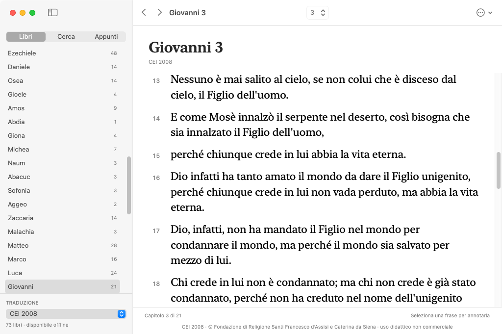
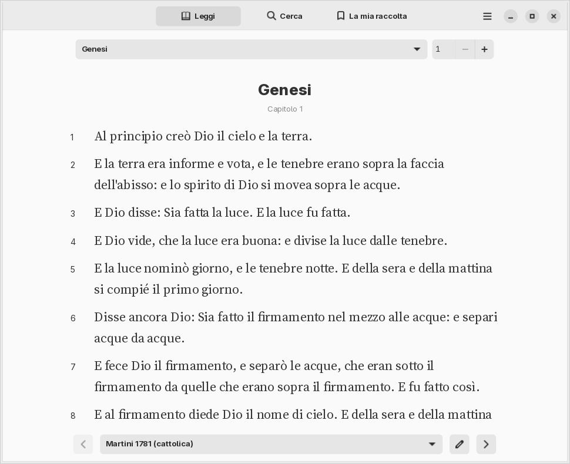
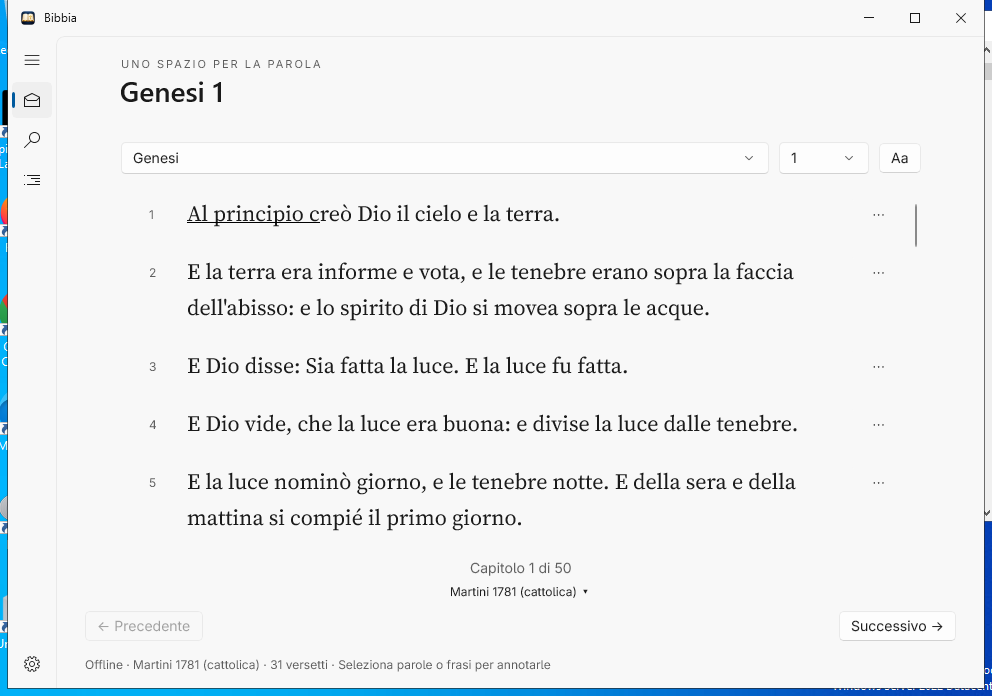

# Bibbia per Windows, GNOME e macOS

**Versione 0.10.0 su Windows, Linux e macOS**, pubblicata in un’unica release.
Lettura su una superficie carta con margini, dorso e ombre; al cambio di capitolo
l’angolo superiore si solleva e la piega scende diagonalmente, trascinando
il resto del foglio in 1.100 ms. Ombre mobili e retro opaco
accompagnano la curvatura.
La modalità Libro impagina anche i capitoli lunghi e il testo conserva selezione e annotazioni native.
Le preferenze di sistema per ridurre le animazioni sono rispettate.

[EXE Windows](https://github.com/Michele-Serafini/Bibbia/releases/download/v0.10.0/Bibbia-Setup-0.10.0-x64.exe) ·
[DEB Linux](https://github.com/Michele-Serafini/Bibbia/releases/download/v0.10.0/bibbia_0.10.0-1_amd64.deb) ·
[RPM Linux](https://github.com/Michele-Serafini/Bibbia/releases/download/v0.10.0/bibbia-0.10.0-1.x86_64.rpm) ·
[DMG macOS Universal](https://github.com/Michele-Serafini/Bibbia/releases/download/v0.10.0/Bibbia-0.10.0-universal.dmg).

macOS è sviluppato interamente in **Swift**, motore compreso, con **SwiftUI e AppKit**.
Usa gli strumenti e i font Apple di sistema e il disegno serif per la lettura.
Supporta macOS 13 Ventura e successivi su Apple Silicon e Intel con un unico pacchetto Universal.
Consulta le [istruzioni macOS e l’architettura](macos/README.md).

Su Windows e Linux il lettore biblico offline usa un motore **Rust** condiviso. Su Linux l’applicazione è
interamente Rust con **GTK4 e libadwaita**, tema e controlli GNOME; su Windows
usa **WinUI 3**. Interfaccia italiana o inglese, chiaro/scuro o tema del desktop,
font **Adwaita Sans e Source Serif 4**, colonna di lettura limitata e interlinea curata.
Nessun browser incorporato, server o account. Progetto indipendente,
non affiliato a GNOME o Bible.com/YouVersion.

## Modalità libro

La modalità **Libro** calcola le pagine dalle righe native: il testo continua
nella pagina successiva anche dentro un versetto lungo. Su finestre ampie
compaiono due pagine affiancate; font e ridimensionamento ricalcolano la lettura.
Le frecce, PagSu/PagGiù e la rotellina navigano le pagine, passando al capitolo
adiacente solo al termine. Il selettore del capitolo permette sempre un salto diretto.
Disattivare **Libro** per tornare allo scorrimento continuo. Il file locale
`reader.json`, accanto al database, conserva modalità e punto di lettura.
Testo, selezioni e annotazioni continuano a usare i controlli del sistema.

## Aspetto

macOS, tema chiaro:



[Schermata macOS scura](docs/screenshots/macos-dark.png). Catture reali della
versione 0.5.0 su macOS 15.7.9; la stessa app Universal è verificata su Apple Silicon e Intel.

GNOME, tema chiaro:



Windows, tema chiaro:



Sono schermate reali della versione 0.4.0 nelle prove Windows Server e Debian 12.
Disponibili anche [GNOME scuro](docs/screenshots/gnome-dark.png) e
[Windows scuro](docs/screenshots/windows-dark.png).

## Funzioni su tutte le piattaforme

- **CEI 2008**, Bibbia cattolica italiana completa di 73 libri, offline, per uso
  formativo e didattico non commerciale secondo le condizioni della fonte ufficiale.
- **Martini 1781**, cattolica italiana di 73 libri, selezionata al primo avvio;
  Diodati 1649 e KJV inglese, ciascuna di 66 libri.
- **Raccolta estesa di 83 libri/sezioni in inglese**: WEB ecumenica con apocrifi,
  più 1 Enoc e Giubilei (Charles 1917). Comprende 1–2 Esdra, 3–4 Maccabei,
  Salmo 151 e Preghiera di Manasse. Non è un canone universale né tutto il canone
  etiopico: non esiste un’unica Bibbia con tutti i canoni. Selettore rapido sotto la lettura.
- Scelta indipendente della lingua dell’app (italiano/inglese) e della Bibbia.
- Icona dedicata; barra del titolo dello stesso colore della finestra, in chiaro e scuro.
- Sfogliamento dei capitoli dall’angolo superiore, con curvatura diagonale,
  ombra mobile e retro opaco.
  Transizioni brevi per titoli, navigazione e pulsanti secondo il toolkit nativo.
  Le animazioni seguono le impostazioni del sistema; le liste sono virtualizzate.
- Navigazione per libro e capitolo; ripresa dell'ultimo versetto selezionato.
- Ricerca senza distinzione maiuscole/minuscole nella traduzione selezionata;
  massimo 200 risultati con indicazione del limite.
- Selezione di parole o frasi con il mouse: barra contestuale compatta, quattro colori,
  sottolineatura, copia, segnalibro e nota in un piccolo popup. Il pulsante ⋯ offre
  anche le azioni sul versetto intero.
- Raccolta degli appunti paginata a 200 elementi, con ritorno al versetto originale.
- Importazione di altre traduzioni JSON, anche italiane, senza sovrascrivere
  traduzioni esistenti o mescolare le relative annotazioni.
- Dati personali locali in SQLite, con transazioni e modalità WAL.

La Martini è una traduzione cattolica storica dalla Vulgata, di pubblico dominio;
conserva il linguaggio e la numerazione della sua edizione. Audio, piani di lettura,
sincronizzazione cloud e catalogo online
YouVersion non sono implementati. I benchmark delle applicazioni native e del
motore sono documentati sotto. Il runtime .NET e WinUI self-contained aumentano
la dimensione del download Windows.

## Architettura

`macos/` contiene il nuovo motore Swift e il frontend SwiftUI/AppKit, con corpus
mappati e SQLite di sistema. [Dettagli e verifiche macOS](macos/README.md).

`core/` contiene corpus, ricerca, importazione, validazione e persistenza in Rust
per Windows e Linux.
`gnome/` è il frontend Linux interamente Rust con i binding ufficiali gtk-rs e
adwaita-rs: usa il motore nello stesso eseguibile e le librerie GTK/libadwaita
di sistema. Una sola `GtkTextView` contiene il capitolo; le ricerche e SQLite
lavorano su un thread dedicato, che resta bloccato in attesa quando è inattivo.
Nessun polling nell’uso normale. Durante lo sfogliamento il frame clock viene
attivato per 1.100 ms e poi rimosso; una sola immagine, limitata a due milioni
di pixel e condivisa dalle parti del foglio, viene liberata al termine. I risultati sono virtualizzati; i font si
registrano solo nel processo e non sostituiscono quelli del desktop.

`app/` resta l’host C#/.NET 8 per i controlli WinUI ufficiali, con due funzioni
C ABI (`bible_request`, `bible_free`) verso lo stesso motore Rust. Solo il frontend
Linux è interamente Rust. I pacchetti delle due piattaforme usano gli stessi
testi e lo stesso schema delle annotazioni; si può trasferire un backup a app chiusa.

## Installare su Linux

Pacchetti **x86-64** per Debian 12+, Ubuntu 24.04+ e Fedora 43+:

- [bibbia_0.10.0-1_amd64.deb](https://github.com/Michele-Serafini/Bibbia/releases/download/v0.10.0/bibbia_0.10.0-1_amd64.deb)
- [bibbia-0.10.0-1.x86_64.rpm](https://github.com/Michele-Serafini/Bibbia/releases/download/v0.10.0/bibbia-0.10.0-1.x86_64.rpm)

```sh
sudo apt install ./bibbia_0.10.0-1_amd64.deb
# Su Fedora:
sudo dnf install ./bibbia-0.10.0-1.x86_64.rpm
```

Aprire **Bibbia** dal menu delle applicazioni oppure eseguire `bibbia`.
Il gestore pacchetti installa le dipendenze mancanti: GTK4 ≥ 4.8, libadwaita ≥ 1.2,
Fontconfig e il tema icone hicolor. Sono librerie condivise, normalmente già
presenti su GNOME. Non servono Rust, .NET o strumenti di sviluppo.
I pacchetti sono di circa 8 MB; il contenuto dell’app installata è di circa 49 MiB.
Queste dimensioni escludono le eventuali dipendenze di sistema mancanti.

Per aggiornare aprire il nuovo pacchetto con lo stesso comando. Per rimuovere
usare `sudo apt remove bibbia` o `sudo dnf remove bibbia`:
appunti e traduzioni importate restano in `$XDG_DATA_HOME/bibbia`, normalmente
`~/.local/share/bibbia/bible.sqlite3`. Chiudere l’app prima di copiare un backup.
`bibbia --data-dir /percorso/assoluto` permette una cartella dati alternativa.

Scorciatoie: **Ctrl+F** cerca, **Ctrl+,** preferenze, **Alt+←/→** capitolo,
**Ctrl+Q** chiude. La lingua del testo è indipendente da quella dell’interfaccia.
Il selettore della traduzione è sotto la lettura; le preferenze includono i filtri
per lingua e il numero dei libri. Il menu della selezione e l’editor delle note
sono piccoli popover nativi.

## Installare su Windows

[Scarica **Bibbia-Setup-0.10.0-x64.exe**](https://github.com/Michele-Serafini/Bibbia/releases/download/v0.10.0/Bibbia-Setup-0.10.0-x64.exe): un solo installer offline,
con interfaccia italiana. Non richiede Rust, .NET, Visual Studio, account o
download aggiuntivi sul PC destinatario. Supporta Windows 10 versione 2004 o
successiva e Windows 11 a 64 bit.

1. Aprire l'installer e seguire la procedura. Non servono privilegi di amministratore.
2. Avviare **Bibbia** dal menu Start; il collegamento sul desktop è facoltativo.
3. Per aggiornare, chiudere Bibbia e aprire il nuovo installer. I dati personali restano al loro posto.
4. Per rimuovere l'app usare **Impostazioni Windows → App → Bibbia → Disinstalla**.
   Note, segnalibri e traduzioni importate vengono conservati.

La [release v0.10.0](https://github.com/Michele-Serafini/Bibbia/releases/tag/v0.10.0)
contiene l'installer e il checksum SHA-256. Per le nuove build il workflow
GitHub Actions **Check and build** produce anche l'artefatto **Bibbia-Installer-x64**.
Il workflow manuale **Publish verified packages** richiede due build riuscite,
**Check and build** e **Build macOS**, della stessa revisione su `main`.
Pubblica insieme EXE, DEB, RPM, DMG e ZIP con i checksum SHA-256, senza ricompilarli.
`VERSION` e `scripts/check-versions.py` impediscono versioni diverse tra i manifest,
i lockfile e i metadati dei pacchetti nativi. Gli eseguibili sono negli allegati
della release, mentre Git conserva il codice che li ha generati.

**Verifica precedente 0.4.0:** [pipeline completata con successo](https://github.com/Michele-Serafini/Bibbia/actions/runs/40151864300), codice applicativo `54bcb66`.

Superati 20 test del motore, la mappatura delle selezioni GTK,
il collegamento C# → Rust e le interfacce reali con mouse: popup, note,
segnalibri, ricerca, lingue, CEI, Enoc e Giubilei, font, colori e riapertura dei dati.
Comprende installazione/aggiornamento/rimozione dei pacchetti Windows e Debian,
RPM con database isolato e installazione RPM con dipendenze su Fedora.
La pubblicazione prende gli stessi binari della pipeline riuscita e ricontrolla
i checksum senza ricompilarli.
La build non è firmata digitalmente; Windows può mostrare un avviso SmartScreen.

## Compilare e avviare su Windows

Richiesti Windows 10 2004 (build 19041) o Windows 11 **x64**, PowerShell 7,
SDK .NET **8.0.426** (fissato in `global.json`), Rust 1.99.1 MSVC e Visual Studio 2022 Build Tools con il workload
**Desktop development with C++**, strumenti MSVC x64, Windows SDK e strumenti
di compilazione **UWP/WinUI** (inclusi i task Appx/PRI di Visual Studio).
Lo script individua e usa MSBuild di Visual Studio; `dotnet publish` da solo
non dispone dei task PRI necessari a questa versione di WinUI.
Usare un terminale Developer PowerShell x64 se il linker non viene trovato.

```powershell
pwsh -File ./scripts/build.ps1 -Run
```

Lo script verifica i test Rust, ripristina le dipendenze NuGet con il lockfile,
genera la DLL x64 e pubblica l'app self-contained
in `artifacts/Bibbia/`. Si può avviare successivamente
`artifacts/Bibbia/Bibbia.Windows.exe`. Conservare **l'intera cartella**, non solo
l'eseguibile. Non occorre installare separatamente .NET o Windows App Runtime
sulla macchina destinataria. Il motore Rust usa il runtime C statico su Windows
per non richiedere il VC++ Redistributable.

Per creare il singolo installer serve anche **NSIS 3**. Su un PC di sviluppo con
tutti i prerequisiti, dalla radice del repository:

```powershell
pwsh -File ./scripts/package.ps1
```

Il risultato è `artifacts/installer/Bibbia-Setup-0.10.0-x64.exe`, con un file
`.sha256` accanto. Il flag `-SkipBuild` riutilizza una pubblicazione già completata.
La cartella `artifacts/Bibbia/` viene sempre rigenerata da una pubblicazione pulita,
per evitare di includere file rimasti da vecchie build.

```powershell
pwsh -File ./scripts/smoke-windows.ps1
```

Su un runner Windows pulito, per provare installazione, aggiornamento, interfaccia
reale, blocco con app aperta, disinstallazione e conservazione dei dati:

```powershell
pwsh -File ./scripts/test-installer.ps1 -Installer ./artifacts/installer/Bibbia-Setup-0.10.0-x64.exe
```

Il test rifiuta di avviarsi se trova dati o un'installazione Bibbia preesistenti.
La prova WinUI usa Windows UI Automation e richiede una sessione desktop interattiva.
Non eseguirla su un profilo con appunti reali.

Il workflow `.github/workflows/check.yml` compila il motore su Linux e l'intera
app su Windows. L'installer viene caricato solo dopo il completamento dei test
Windows. Per pubblicarlo, avviare `publish-release.yml` dalla scheda Actions e
indicare i numeri delle build **Check and build** e **Build macOS** riuscite
sul ramo `main`, entrambe relative allo stesso commit.

## Compilare l’interfaccia GNOME e i pacchetti

Su Debian 12/Ubuntu 24.04, oltre al Rust 1.99.1 fissato nel repository:

```sh
sudo apt install build-essential pkg-config libgtk-4-dev libadwaita-1-dev libfontconfig1-dev
cargo run -p bibbia-gnome
cargo build --release --locked -p bibbia-gnome
```

Per creare entrambi i pacchetti:

```sh
sudo apt install rpm desktop-file-utils appstream-util python3
python3 scripts/package-linux.py
```

I risultati sono in `artifacts/linux/`. Il builder verifica versione, risorse,
metadati desktop/AppStream, assenza di RPATH e requisito GLIBC ≤ 2.36. La pipeline
compila sul riferimento Debian 12, quindi prova l’RPM anche su Fedora.
Il file `Cargo.lock` fissa i binding GTK/adwaita; `default-members = ["core"]`
consente alle build Windows del motore di procedere senza librerie GTK.

Per le prove dell’interfaccia Linux e del pacchetto in una sessione isolata:

```sh
sudo apt install xvfb xauth xdotool dbus-x11
xvfb-run -a -s '-screen 0 1280x960x24' dbus-run-session -- python3 scripts/test-linux-packages.py
```

Non usare le opzioni `--install-deb` o `--installed-rpm` su un computer personale:
sono riservate ai container CI puliti e installano/rimuovono il pacchetto.
Le prove predefinite estraggono il DEB e installano l’RPM in un database privato,
verificando che la rimozione lasci intatti appunti e file non appartenenti al pacchetto.
Le opzioni di test dell’eseguibile richiedono una cartella dati isolata e rifiutano
di sovrascrivere un database preesistente.

## Sviluppare il motore su Linux

```sh
cargo test --locked
cargo clippy --locked --all-targets -- -D warnings
cargo fmt --all -- --check
cargo build --release --locked
python3 scripts/smoke-core.py
dotnet run --project tests/Bibbia.InteropSmoke -- target/release/libbible_core.so
```

Il toolchain è fissato in `rust-toolchain.toml`. L'interfaccia WinUI 3 si compila
e si esegue su Windows; Linux supporta lo sviluppo e i test del motore.
Usare il checkout esistente: ogni task cloud è già isolato, non serve un worktree.

Il test C# usa lo stesso collegamento nativo dell'app e controlla testo italiano,
UTF-8, note dopo la riapertura, importazione con nomi contenenti spazi, ricerca ed
errori gestiti. Chiude il database prima di rimuovere i dati temporanei, anche su Windows.

## Importare altre traduzioni

CEI 2008 e Martini cattoliche italiane sono già incluse e funzionano offline senza importazioni.
Nelle impostazioni puoi scegliere la lingua dell’interfaccia e filtrare le
traduzioni per lingua. Seleziona **Italiano → CEI 2008** oppure **Martini 1781 (cattolica)** per la
Bibbia cattolica completa.
Le installazioni esistenti mantengono la traduzione scelta nell'ultima lettura;
per cambiarla usare il selettore sotto il capitolo oppure **Aspetto e traduzioni → Traduzione**.
Per gli apocrifi e gli altri canoni scegliere **Raccolta estesa (83 sezioni)**: il testo è in inglese.

In **Aspetto e traduzioni → Importa traduzione JSON**, scegliere un testo di cui
si possiedono i diritti e assegnargli un nome univoco. Formato UTF-8, massimo 32 MB:

```json
[
  {
    "abbrev": "gen",
    "name": "Genesi",
    "chapters": [
      ["Testo del versetto 1", "Testo del versetto 2"],
      ["Primo versetto del capitolo 2"]
    ]
  }
]
```

Ogni libro contiene capitoli, ogni capitolo contiene versetti. Numeri e ordine
sono ricavati dagli array. Un campo facoltativo `labels`, con gli stessi array di
capitoli e un’etichetta per versetto, conserva numerazioni come `4a` o `15-16`;
non deve contenere etichette vuote o duplicate nello stesso capitolo. Sono ammessi anche corpus parziali. Le traduzioni
moderne disponibili su Bible.com non sono automaticamente redistribuibili;
nessuno scraping o download da quel servizio viene effettuato dall'app.

## Dati e backup

Percorsi: `%LOCALAPPDATA%\BibbiaRust\bible.sqlite3` su Windows;
`$XDG_DATA_HOME/bibbia/bible.sqlite3` (di solito `~/.local/share/bibbia/bible.sqlite3`) su Linux.
L'app non trasmette dati. Per il backup chiudere l'app, poi copiare la cartella
`BibbiaRust` intera (compresi eventuali file `-wal` e `-shm`). Per ripristinare,
chiudere l'app e ripristinare la cartella. I file non sono cifrati; usare le
protezioni dell'account Windows per dati sensibili.

## Controlli manuali aggiuntivi su Windows

1. Avviare l'app; controllare che la Martini cattolica sia selezionata al primo avvio.
   Verificare la presenza di Tobia, Giuditta, Sapienza, Siracide, Baruc e Maccabei.
   Aprire Genesi 1, poi Giovanni 3 con libro e capitolo.
2. Cercare `talmente amato il mondo`; aprire Giovanni 3:16 dai risultati.
   Cercare poi una sola lettera: deve apparire un errore senza risultati precedenti.
3. Selezionare parole con il mouse: deve apparire un menu compatto.
   Scegliere un colore, sottolineare solo la frase selezionata, salvare una nota
   con accenti e un segnalibro. Controllare la raccolta e il pulsante Copia.
4. Chiudere e riaprire: controllare note, ultimo versetto selezionato, tema e dimensione testo.
5. Rimuovere la formattazione dalla selezione, il segnalibro e la nota:
   quando non restano annotazioni, il versetto deve sparire dalla raccolta.
   Cambiare lingua dell’app senza cambiare la traduzione e provare i filtri italiano/inglese.
   Controllare che anche la barra superiore segua i temi chiaro/scuro e Windows.
6. Importare un JSON italiano autorizzato con spazi all'inizio e alla fine del nome;
   controllare selezione automatica della traduzione, lettura, ricerca e
   isolamento delle annotazioni tra traduzioni. Un file malformato deve mostrare
   un errore e lasciare intatti i dati.
7. Controllare tema Windows, contrasto elevato, tastiera, ridimensionamento e DPI
   al 100/150/200%. Verificare su un PC Windows senza SDK con la cartella pubblicata.

La pipeline verifica già anche selezione con mouse, note, lingue e tema nell’interfaccia reale.
Questi controlli aggiuntivi estendono la verifica ad accessibilità, DPI
e PC Windows 10/11 diversi dal runner Windows Server 2022.
Vedere [THIRD_PARTY_NOTICES.md](THIRD_PARTY_NOTICES.md) per fonti e licenze.

## Prestazioni e fonti dei testi

La 0.10.0 riduce il testo e i controlli nascosti: Windows crea gli editor delle
pagine visibili; GNOME usa due documenti nativi nel confronto; macOS crea la
seconda pagina soltanto quando serve e riusa l'impaginazione. Le annotazioni
macOS aggiornano soltanto i versetti cambiati. L'indice delle corrispondenze
comune ai motori occupa 20 KB invece di 146 KB, senza perdere riferimenti.

Le pipeline native eseguono anche un confronto A/B con la 0.9.0, compilata sulla
stessa macchina con gli stessi hook di misura. Tre profili nuovi per versione,
ordine alternato, finestra a una e due colonne, Salmo 119 CEI e confronto KJV,
otto cicli di navigazione e animazione. I diagnostici dei workflow contengono
`*performance-comparison.json` con tutti i campioni e gli hash degli eseguibili.
Per riprodurre, compilare il riferimento con `scripts/build-performance-baseline.py`
e passare entrambi gli eseguibili a `scripts/compare-performance.py`.
RSS, memoria privata e PSS sono metriche distinte; confrontarle soltanto sullo
stesso sistema. Nessun GC forzato, purge dell'allocatore o working set trimming.
Il renderer e le librerie del desktop incidono sul totale; nessun obiettivo
assoluto di RAM viene garantito su macchine diverse.

Il motore genera indici UTF-8 e testo per la ricerca durante la compilazione.
I corpus inclusi restano in sezioni di sola lettura della DLL; viene letto solo
il catalogo della traduzione utilizzata. Un capitolo carica tutte le annotazioni
con una query SQLite, le impostazioni identiche non vengono riscritte e viene
mantenuta al massimo una traduzione importata in memoria. Il catalogo delle
importazioni precedenti viene migrato una volta, senza modificare testi o appunti.
Se un vecchio import usa il nome di una nuova traduzione inclusa, riceve il suffisso
«importata»: annotazioni e posizione seguono il testo originale in una transazione.
Il ridimensionamento del testo aggiorna le righe esistenti con un limite di
frequenza, senza ricaricare il capitolo.

Microbenchmark riproducibile del **solo motore nativo su Linux**, build release,
mediana di 7 processi nuovi, file già nella cache del sistema, stessa macchina:

| Misura | v0.2.0 | v0.3.0 |
| --- | ---: | ---: |
| Inizializzazione motore | 11,742 ms | 0,764 ms |
| Genesi 1, media di 200 letture | 0,219 ms | 0,112 ms |
| Ricerca senza risultati, media di 40 scansioni | 10,121 ms | 0,676 ms |
| RSS del processo Python + DLL dopo queste operazioni | 43,637 MiB | 19,469 MiB |

Fixture: Martini 1781, ricerca `zzxyzznonexistent`. Le ricerche risultano circa
15 volte più rapide e il processo di misura usa circa il 55% di memoria residente
in meno, pur includendo due raccolte aggiuntive nella nuova DLL. Questi numeri
**non misurano la RAM o l’avvio dell’intera app WinUI su Windows** e dipendono
dalla macchina e dalla ricerca. Risultati grezzi in `docs/performance/`; comando:

```sh
python3 scripts/benchmark-core.py
python3 scripts/verify-corpora.py
```

Per riprodurre i nuovi corpus, installare `beautifulsoup4 lxml` solo nell’ambiente
di sviluppo e usare `scripts/import-cei.py --cache CARTELLA` e
`scripts/import-extended.py WEB_VPL_ZIP WEB_USFM_ZIP --enoch ENOCH_HTML --jubilees-cache CARTELLA`.
Gli URL e gli hash di ogni input sono nei manifest `*-source.json`; il convertitore
CEI scarica pagine mancanti solo con `--download`. L’app installata non scarica
questi testi: sono già inclusi. I versetti con lettere, quelli combinati e le
lacune della fonte mantengono le etichette originali. In Ester CEI, **G** indica
il testo greco, **E** quello ebraico, entrambi presenti nell’edizione ufficiale.

Il codice è MIT; **i testi hanno licenze separate**. La CEI è riservata agli usi
formativi e didattici non commerciali previsti dalla fonte, con attribuzione
visibile nel lettore. Licenze, condizioni e manifest sono inclusi nell’installer.
Vedere [THIRD_PARTY_NOTICES.md](THIRD_PARTY_NOTICES.md).

## Prestazioni dell’app GNOME completa

Misura precedente della build 0.4.0 Linux x86-64, profili nuovi, Martini Genesi 1,
finestra 980×800, GTK4 4.18/libadwaita 1.7, X11/Xvfb con renderer software Cairo.
Mediana di tre processi nuovi nella stessa macchina di prova:

| Misura | Macchina di sviluppo | CI Debian 12 |
| --- | ---: | ---: |
| Finestra pronta dopo il primo rendering | 304 ms | 152 ms |
| Memoria residente RSS, librerie e font inclusi | 93,1 MiB | 101,0 MiB |
| Memoria proporzionale PSS | 79,2 MiB | 76,3 MiB |
| Pagine private residenti, pulite e modificate | 68,2 MiB | 53,3 MiB |
| CPU a riposo, campioni da 3 secondi | nessun tick registrato | nessun tick registrato |

Sono misure del processo completo, escluse quelle del server grafico e del resto
del desktop. Le pagine delle librerie possono essere condivise con altre app.
Non sono misure di Windows né una garanzia per altri renderer, GPU, schermi o
font installati. I risultati grezzi sono in
[docs/performance/v0.4.0-gnome-linux.json](docs/performance/v0.4.0-gnome-linux.json).
Il [secondo risultato](docs/performance/v0.4.0-gnome-debian12-ci.json) usa GTK4 4.8/libadwaita 1.2 sul riferimento Debian 12, con lo stesso renderer e procedura; le macchine sono diverse.

```sh
xvfb-run -a -s '-screen 0 1280x960x24' dbus-run-session -- \
  python3 scripts/benchmark-linux.py --binary /percorso/installato/usr/bin/bibbia
```

La CPU resta inattiva senza timer di polling, con cursore di lettura non
lampeggiante; ricerca e scritture SQLite si attivano in risposta alle azioni.
I capitoli non ricreano controlli per ogni versetto. Il testo e gli indici
rimangono nelle sezioni di sola lettura dell’eseguibile, e le raccolte di appunti
caricano solo 200 elementi per pagina su entrambe le piattaforme.

## Traduzioni a confronto

Nel lettore premi **Confronta** e scegli la seconda traduzione. CEI 2008 e
le altre versioni incluse sono disponibili offline. Le due colonne condividono
lo scorrimento e l'altezza di ogni riga, quindi lo stesso riferimento resta
affiancato anche con testi di lunghezza diversa. **↗** apre il versetto
nella rispettiva versione, con tutte le funzioni di annotazione.

L'allineamento conserva i riferimenti originali e gestisce i riferimenti
verificati dei Salmi, di Gioele e Malachia. Le numerazioni non verificate e i
libri assenti vengono segnalati; il programma non inventa corrispondenze.
La seconda traduzione scelta viene conservata per gli avvii successivi.

Su Windows l'installer registra Bibbia nelle App installate con la dimensione
reale della cartella di installazione. Start e ricerca usano un'identità
coerente con l'app; è presente anche il collegamento **Disinstalla Bibbia**.
La rimozione conserva appunti, segnalibri e impostazioni personali.
